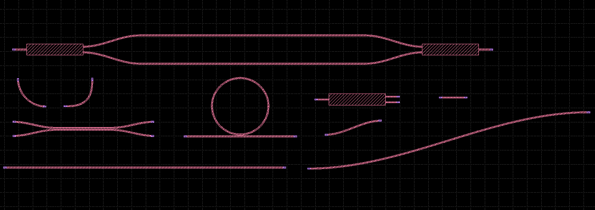
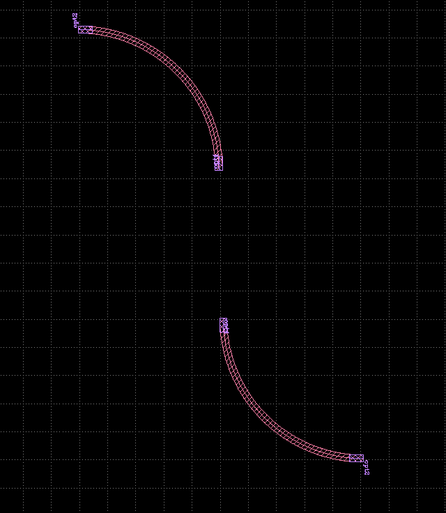
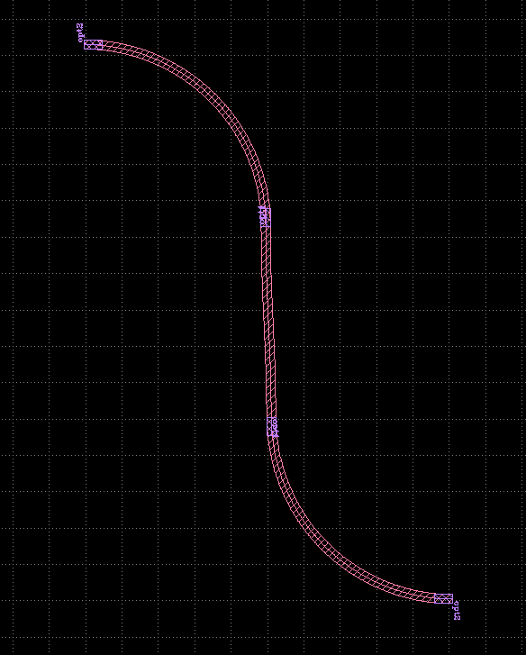
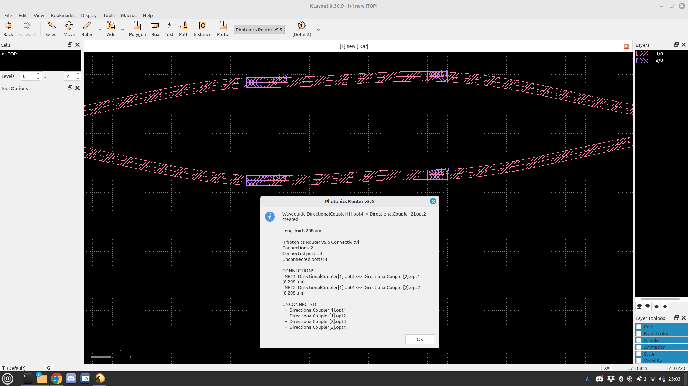
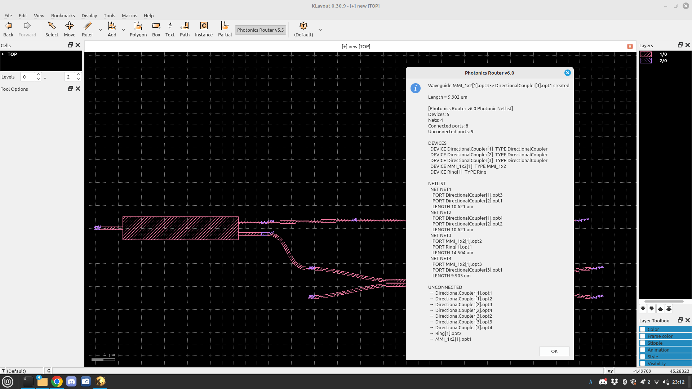
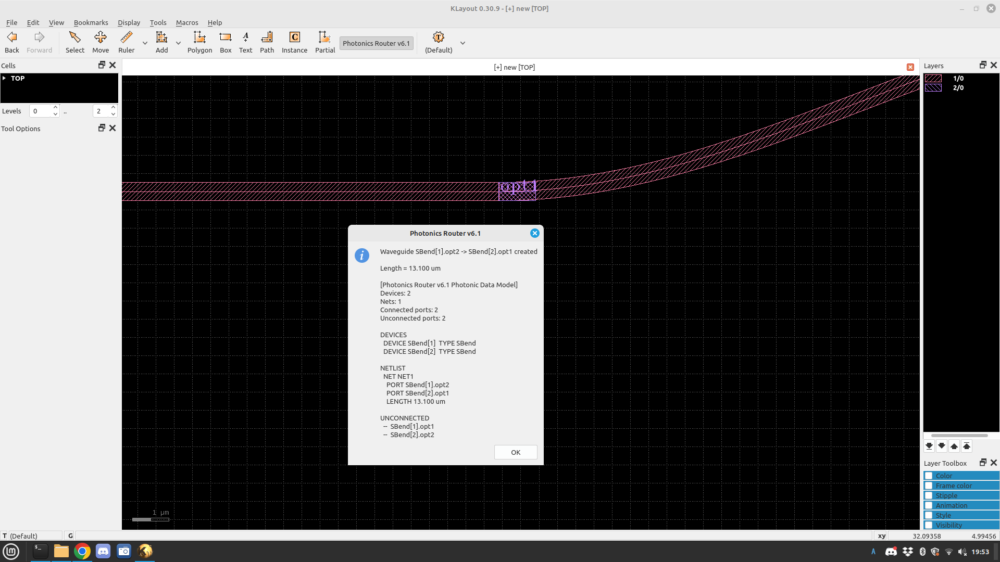

# KLayout Silicon Photonics PDK

[English](README_en.md)

**KLayout 0.30.9** 向けのオープンソース Silicon Photonics PCell
ライブラリと、対話型導波路ルーターです。

> **開発状況:** 初期開発・ジオメトリプロトタイプ
> 現時点ではファウンドリ認定済みの Silicon Photonics PDK ではありません。

## 概要

KLayout の PCell（Parameterized Cell）機能を利用して、Silicon Photonics
向けの基本的な光デバイスをパラメトリックに生成します。また、PCell
に定義された光ポート間を導波路で接続する **Photonics Router** を開発しています。

Router v6.1 では `PhotonicDevice`、`OpticalPort`、`PhotonicNet` のデータモデルを導入しました。
**最新の Router v6.4（Phase 3E-6.1）** では、2クリックGUIから導波路レイヤ `1/0` と
専用障害物レイヤ `90/0` を考慮した CSC / Waypoint 迂回ルーティングを実行できます。
本機能は KLayout 0.30.9 の統合テストとGUI画面で動作確認済みです。

## 対応環境

- KLayout `0.30.9`
- KLayout Python API
- Linux

# PCell Library v4

登録ライブラリ名：`Photonics`

| PCell | 機能 |
|---|---|
| `Straight` | 直線導波路 |
| `Bend90` | 90°ベンド |
| `EulerBend` | Euler 系ベンド |
| `SBend` | S ベンド |
| `Ring` | リング共振器 |
| `DirectionalCoupler` | 方向性結合器 |
| `MMI_1x2` | 1入力2出力 MMI |
| `MZI` | Mach-Zehnder Interferometer |
| `WaveguideRoute` | Bézier 曲線による導波路 |
| `PortConnector` | 光ポート接続用導波路 |



# レイヤ定義

| 用途 | Layer / Datatype |
|---|---|
| Waveguide | `1/0` |
| Optical Pin | `2/0` |
| Obstacle (専用障害物) | `90/0` |

# Photonics Router

基本操作：

```text
始点ポートをクリック
       ↓
終点ポートをクリック
       ↓
導波路を自動生成
       ↓
接続情報・光路長を抽出
```

## Router 開発履歴

| Version | 主な機能 | 状態 |
|---|---|---|
| v5.1 | 2クリックによる導波路生成 | ✅ KLayout 0.30.9 動作確認済み |
| v5.2 | 光ポート位置への自動スナップ | ✅ KLayout 0.30.9 動作確認済み |
| v5.3 | ポート方向認識 | API互換性問題 |
| v5.3.1 | `each_point()` 対応 | 修正版 |
| v5.3.2 | 光ポート位置＋方向認識 | ✅ KLayout 0.30.9 動作確認済み |
| v5.4 | ループ抑制＋経路形状の自動調整 | ✅ KLayout 0.30.9 動作確認済み |
| v5.5 | Port metadata＋Waveguide length | ✅ KLayout 0.30.9 動作確認済み |
| v5.6 | Connectivity verification | ✅ KLayout 0.30.9 動作確認済み |
| v6.0 | Photonic Netlist Extraction | ✅ KLayout 0.30.9 動作確認済み |
| **v6.1** | **Photonic Data Model** | **✅ KLayout 0.30.9 動作確認済み** |
| v6.2 | Bend-aware CSC / tangent verification | KLayout tests verified |
| v6.3 | Independent routing engine and KLayout GUI adapter | KLayout GUI verified |
| **v6.4** | **Obstacle-aware routing, waypoint fallback, `90/0` obstacle layer** | **KLayout integration + GUI verified (prototype)** |

## Router v5.4

v5.4 では、ポート位置・方向認識を継承しながら、Bézier 曲線が不要に
大回りしたりループ状になったりする問題を改善しました。





## Router v5.5
Connections: 2
Connected ports: 4
Unconnected ports: 4
```



# Photonics Router v6.0

**Photonics Router v6.0 は KLayout 0.30.9 で動作確認済みです。**

v6.0 では、レイアウト上のPCell、Native Port、インスタンス、導波路接続を
解析して基本的な Photonic Netlist を生成します。

主な機能：

- Device recognition
- Instance identification
- Native PCell port name recognition
- Connection extraction
- `PhotonicNet` オブジェクト
- Connected / Unconnected port detection
- NetごとのWaveguide length
- Photonic Netlist表示

出力例：

```text
DEVICES
  DEVICE DirectionalCoupler[1] TYPE DirectionalCoupler
  DEVICE MMI_1x2[1] TYPE MMI_1x2
  DEVICE Ring[1] TYPE Ring

NETLIST
  NET NET1
    PORT DirectionalCoupler[1].opt3
    PORT DirectionalCoupler[2].opt1
    LENGTH 10.621 um

  NET NET3
    PORT MMI_1x2[1].opt2
    PORT Ring[1].opt1
    LENGTH 14.504 um
```

DirectionalCoupler、MMI、Ring を含む異種PCell間でもDevice / Port /
Connection / Lengthを抽出できることを確認しています。



## v6.0 データフロー

```text
Layout
  ↓
Device Recognition
  ↓
Native PCell Port Recognition
  ↓
Instance Identification
  ↓
Connection Extraction
  ↓
PhotonicNet
  ↓
Photonic Netlist
```

# Photonics Router v6.1 — Photonic Data Model

**Photonics Router v6.1 は KLayout 0.30.9 で動作確認済みです。**

v6.1 では v6.0 のルーティング動作と Photonic Netlist Extraction を維持しながら、
光回路の内部表現を明示的なデータモデルとして整理しました。

```text
PhotonicDevice
      |
      +-- OpticalPort
               |
               +-- PhotonicNet
```

主な追加点：

- `PhotonicDevice` オブジェクトを追加
- `PhotonicDevice <-> OpticalPort` の関連付け
- `OpticalPort <-> PhotonicNet` の関連付け
- Native PCell port metadata を維持
- Photonic Netlist extraction を維持
- Waveguide length extraction を維持
- v6.0 の2クリック対話型ルーティング動作を維持

動作確認例：

```text
DEVICES
  DEVICE SBend[1] TYPE SBend
  DEVICE SBend[2] TYPE SBend

NETLIST
  NET NET1
    PORT SBend[1].opt2
    PORT SBend[2].opt1
    LENGTH 13.100 um

UNCONNECTED
  -- SBend[1].opt1
  -- SBend[2].opt2
```

このデータモデルは、v6.2 の Bend-aware Router、Photonic Verification、
Netlist Export へ発展させるための基盤です。



# Photonics Router v6.4 — 障害物回避（Phase 3E）

v6.4 は KLayout ネイティブの2クリックGUIを維持しながら、既存導波路 `1/0` と
障害物専用レイヤ `90/0` を認識して迂回経路を生成する試作版です。
`2/0` は光ポートのPathとラベルに使用します。

## Phase 3E 開発・検証履歴

| Phase | 内容 | 確認状況 |
|---|---|---|
| 3E-3 | KLayout Regionによる障害物クリアランス付きCSC探索 | テスト済み |
| 3E-4 | CSCで迂回できない場合のWaypoint経路探索 | テスト済み |
| 3E-5 | GDS出力・再読込とクリアランス再検証 | テスト済み |
| 3E-5.1 | 接線角度・3点曲げ半径診断、G1フィレット試作 | テスト済み（連続曲率の保証ではない） |
| 3E-6 | GUIルーター統合、経路配置・失敗時非配置 | KLayoutテストPASS |
| **3E-6.1** | **`90/0`障害物認識、GUI迂回表示** | **KLayoutテスト＋GUI確認済み** |

### 実測例：Waypoint迂回

KLayout 0.30.9、DBU = `0.001 µm`、導波路幅 `0.5 µm`、
要求最小曲げ半径 `5.0 µm` の検証例です。

| 項目 | 結果 |
|---|---:|
| 光ポート間隔 | 80 µm |
| 障害物 | `90/0`、中央の矩形（x=37–43 µm、y=-3–3 µm） |
| 経路 | `WAYPOINT_CSC` |
| 経路長 | 82.056 µm |
| サンプル点数 | 148 |
| 設計／3点近似最小曲げ半径 | 6.250 / 6.250 µm |
| 最大ポリライン方向変化 | 0.442939° |
| GUIでの両端接線誤差 | 約0.221° |
| 独立クリアランス確認 | PASS |

GUIでは、2つの未接続光ポートを選択し、中央の `90/0` 障害物の上側を迂回する
経路を確認しました。テストでは導波路レイヤへのPolygon配置と、
迂回経路が見つからない場合にレイアウトを変更しない **fail-closed** 動作も確認しています。

### インストールとテスト

リポジトリのルートで実行します。

```bash
python3 -m unittest discover -s tests -p 'test_route_continuity.py' -v
klayout -b -r tests/test_klayout_smooth_waypoint.py
klayout -b -r tests/test_router_v64_klayout.py
klayout -b -r tests/test_router_v64_obstacle_layer.py
cp pymacros/photonics_router_v6_4.lym ~/.klayout/pymacros/
```

マクロをコピーした後、KLayoutを完全に再起動してください。
旧Routerマクロの重複登録に注意してください。

### 現時点の制限と次の開発

- 現状の曲率評価はサンプル点による近似です。厳密なG1/G2連続性や製造可能性は保証しません。
- ポート接続部の障害物処理は試作段階です。完全なPDK DRCではありません。
- Polygonで配置した経路のPhotonic Netlist抽出は今後の対応項目です。
- **Phase 3E-7（予定）:** 接続部の接線・曲率プロファイル、自己交差、GDS形状精度の評価。
- **Phase 3E-8（予定）:** Polygon導波路を含むPhotonic Netlist統合。

### GitHub 開発履歴

- `1c75db5` — Waypoint obstacle avoidance
- `e3ff675` — GDS export and visualization
- `6ab87c6` — Obstacle-layer-aware Photonics Router v6.4
- `e762712` — Route continuity and G1 fillet diagnostics

# Router 基本パラメータ

| Parameter | Value | 内容 |
|---|---:|---|
| `WG_WIDTH` | `0.5 µm` | 導波路幅 |
| `SNAP_RADIUS` | `4.0 µm` | 光ポート探索範囲 |
| `MIN_LEAD` | `4.0 µm` | 最小制御距離 |
| `MAX_LEAD` | `20.0 µm` | 最大制御距離 |
| `NPTS` | `96` | Bézier 曲線の分割点数 |
| `WG_LAYER` | `1/0` | 導波路レイヤ |
| `PIN_LAYER` | `2/0` | 光ポートレイヤ |
| `OBSTACLE_LAYER` | `90/0` | 障害物専用レイヤ（v6.4） |

# インストール

```text
~/.klayout/pymacros/
├── photonics_pdk_v4.lym
├── photonics_router_v6_1.lym
└── photonics_router_v6_4.lym
```

旧Routerとの重複登録を避ける場合は、使用しない旧バージョンを
`pymacros` 外へ移動してください。変更後は KLayout を完全終了して再起動します。

# リポジトリ構成

```text
klayout-photonics-pdk/
├── README.md
├── README_en.md
├── LICENSE
├── images/
│   ├── router_v5_4_connected.png
│   ├── router_v5_4_segments.png
│   ├── router_v5_5_length_curved.png
│   ├── router_v5_5_length_straight.png
│   ├── router_v5_5_1_native_ports.png
│   ├── router_v5_5_2_instance_ports.png
│   ├── router_v5_6_connectivity.png
│   ├── router_v5_6_two_nets.png
│   ├── router_v6_0_netlist.png
│   └── router_v6_1_photonic_data_model.png
├── pymacros/
│   ├── photonics_pdk_v4.lym
│   ├── photonics_router_v5_3_2.lym
│   ├── photonics_router_v5_4.lym
│   ├── photonics_router_v5_5.lym
│   ├── photonics_router_v5_6.lym
│   ├── photonics_router_v6_1.lym
│   └── photonics_router_v6_4.lym
├── docs/
├── examples/
└── tests/
```

# 開発ロードマップ

## v6.0 — Photonic Netlist Extraction

- Device recognition
- Instance identification
- Native port recognition
- Connectivity extraction
- Photonic Netlist extraction

**Status: Completed (prototype)**

## v6.1 — Photonic Data Model

- `PhotonicDevice`
- `OpticalPort`
- `PhotonicNet`
- Device / Port / Net relationship

**Status: Completed — KLayout 0.30.9 verified**

## v6.2 — Bend-aware Router

- CSC経路探索、最小曲げ半径、接線角度の検証

**Status: 実装・検証済み（プロトタイプ）**

## v6.3 — RoutingEngine / KLayout Adapter

- 独立したRoutingEngineとGUIアダプター

**Status: 実装・検証済み（プロトタイプ）**

## v6.4 — Obstacle-aware Router

- `1/0`導波路と`90/0`専用障害物を認識
- CSC / Waypoint迂回、クリアランス検証、fail-closed配置

**Status: Phase 3E-6.1までKLayout統合テスト・GUI確認済み**

## Phase 3E-7 / 3E-8（予定）

- 曲率・接線連続性の品質評価
- Polygon導波路のPhotonic Netlist統合

## v7.0 — Advanced Router

- Euler / Clothoid bend
- Waveguide types
- Advanced routing

# ライセンス

MIT License

```text
Copyright (c) 2026 TAKE-HooJoo@SIG
```

# 注意事項

本ソフトウェアは現状のまま（AS IS）提供されます。現在の PCell
寸法、デバイス形状、ルーティング形状、および抽出されたPhotonic Netlistは、
特定の Silicon Photonics 製造プロセスに対する製造可能性、光学性能、
信頼性を保証するものではありません。

# Author

**TAKE-HooJoo@SIG**

Open-Source Silicon Photonics PDK / KLayout PCell Development
